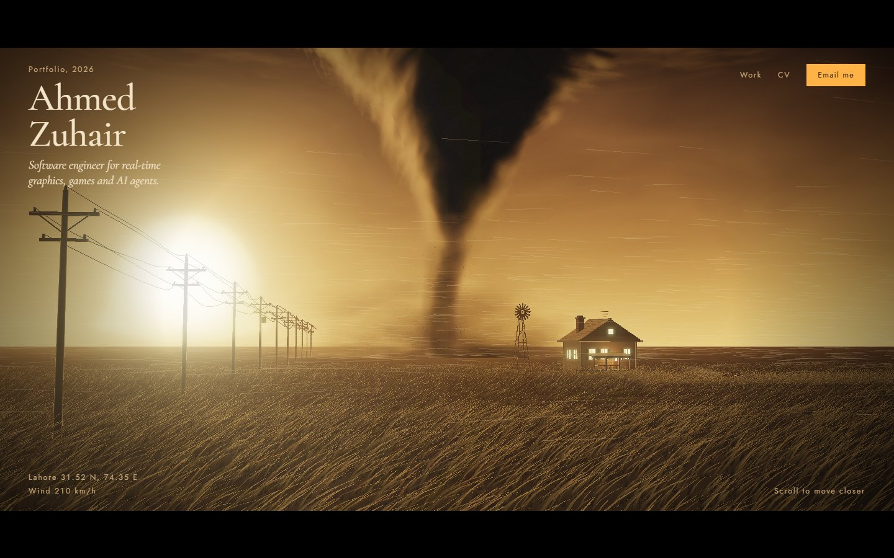
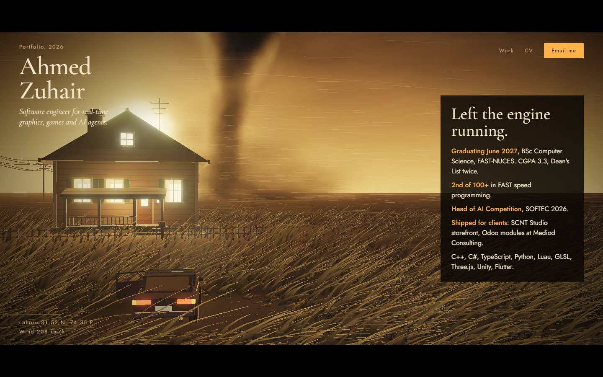
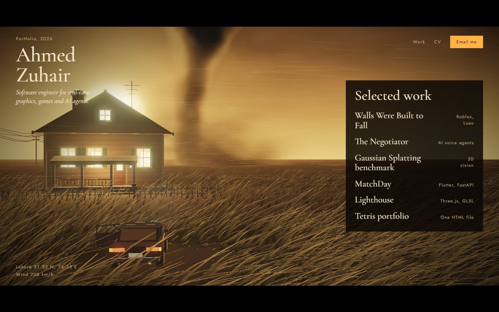
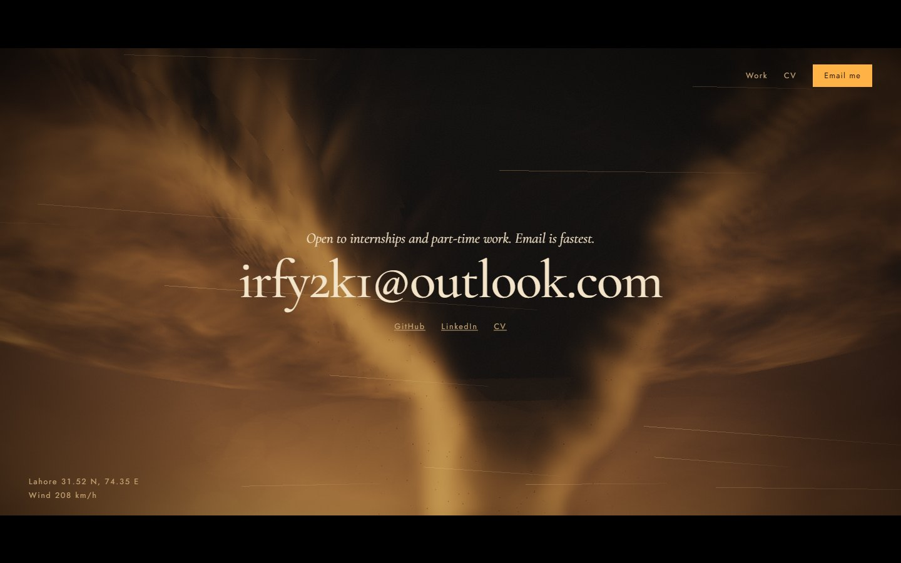

# Storm

A single-page portfolio concept for Ahmed Zuhair. A real-time WebGL tornado at night, and you scroll your way into it.

Everything lives in one file, [`index.html`](index.html). No build step, no bundler, no npm.

**Live:** <https://irfy2k.github.io/storm/>



## Concept

The page opens on a distant supercell over open grass. Scrolling moves the camera toward the funnel while three captions fade in on the way: a summary, selected work, and contact.
## Screenshots

| Approach | Selected work |
|---|---|
|  |  |



## What is in the scene

- A farmhouse with lit windows, a windmill, a power line and a pickup truck in a wheat field
- Procedural sky, lightning flashes and a rotating cloud ceiling, all in GLSL
- Volumetric funnel drawn by a fragment shader on a box volume
- Debris particles and additive wind streaks
- Instanced grass that bends in the wind
- Bloom post-processing, film grain and vignette

## Tech

- [Three.js](https://threejs.org) r128 with `EffectComposer` and `UnrealBloomPass`, loaded from a CDN with Subresource Integrity hashes
- Cormorant Garamond and Jost from Google Fonts
- Vanilla HTML, CSS and JavaScript

## Run it

Open `index.html` in a browser, or serve the folder:

```bash
python -m http.server 8000
```

Then visit <http://localhost:8000>. An internet connection is needed for the CDN scripts and fonts.

## Behaviour notes

- Scroll drives the camera and captions, so the page still works if WebGL fails. It falls back to a still gradient background.
- `prefers-reduced-motion` is respected.
- Pixel ratio is capped to keep the shaders fast on high-DPI screens.

## Part of a series

One of several portfolio concepts. See [irfy2k.github.io](https://irfy2k.github.io) for the main site.
